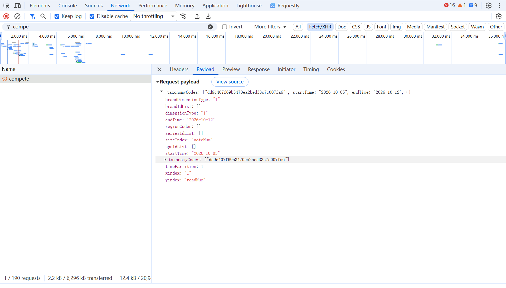

# 行业竞争数据

按行业、时间粒度和指标获取灵犀竞争气泡图数据，导出分指标工作表。

## 能帮你做什么

获取灵犀“行业 → 市场机会 → 市场分析 → 市场竞争分析”中的竞争气泡图原始数据。可选择品牌、SPU 或系列，以及 X 轴、Y 轴和气泡大小指标。

## 开始前准备

- 需要智采中的“行业竞争数据”工具访问权限，以及本团队可用的灵犀平台账号。
- 先从“选择常用行业”中找需要的行业；找不到时再获取行业编号并新增，步骤见下方“输入资料怎么获取”。
- 地域、品牌、商品和系列筛选均可先留空。确实需要限定范围时，再按“输入资料怎么获取”查找编号；中文名称不能代替编号。

## 输入资料怎么获取

先看常用行业下拉：已有需要的行业时，直接选择，不用获取 code。code 可以理解为平台给行业分配的编号；只有新增行业或限定地域、品牌、商品时才需要查看编号。

第一次建议：选择一个已有行业，查询一小段时间，高级筛选全部留空，先确认能得到所需结果。SPU 可理解为平台中的商品条目，系列指产品系列。

1. 在电脑浏览器登录灵犀（idea.xiaohongshu.com），进入“行业 → 市场机会 → 市场分析 → 市场竞争分析”。
2. 按 F12 打开“开发者工具”（也可右键页面，选择“检查”），点击 Network / 网络。若标签被折叠，在右侧“»”中查找。
3. 选择 Fetch/XHR，清空筛选框。在保持网络面板打开的情况下，回到灵犀，选择目标行业及需要限定的品牌、商品或地域，触发一次查询；若没有新请求，可刷新后重新选择条件。
4. 在网络面板的筛选框输入 compete，点击路径包含 /industry/brand/compete 的请求。应选择刚才查询后产生的那条请求。
5. 打开 Payload / 载荷，再展开 Request Payload / 请求载荷，按下表查找字段。这里看的是本次查询“提交了哪些条件”，不是 Response / 响应中的结果。
6. 只复制需要的编号，回到智采填写。新增行业时填行业名称和行业 code；高级筛选中多个编号用英文逗号分隔。

| 智采输入项 | Payload 字段 | 复制什么 |
| --- | --- | --- |
| 行业 code | taxonomyCodes | 当前行业对应的值；新增行业一次填写一个 code。 |
| 地域 code | regionCodes | 选定地域对应的编号；不限定地域时留空。 |
| 品牌 ID | brandIdList | 选定品牌对应的编号。 |
| SPU ID | spuIdList | 选定商品对应的编号。 |
| 系列 ID | seriesIdList | 选定系列对应的编号。 |

格式示例（虚构，不能直接使用）：若 Payload 显示 brandIdList: ["12345", "67890"]，智采品牌 ID 栏填写 12345,67890；不要复制字段名、方括号或引号。行业名称按灵犀平台显示的名称原样填写，行业 code 则必须保留平台原值。

### 字段是 []，或者找不到对应字段怎么办？

[] 表示这条请求没有提交该项筛选。先在灵犀选定对应条件，再查看新产生的请求；不要拿其他字段的编号代填。非必填筛选可先留空。

### 列表里没有 compete 请求怎么办？

清空网络筛选后重新操作；确认打开的是市场竞争分析页面，网络记录没有暂停。页面位置或请求名称若与说明不同，请联系配置人协助定位，不要猜编号。

### 怎么确认复制对了？

回到灵犀确认该次查询选中的名称，再核对 Payload 的对应字段；第一次只选择一个行业或一个对象。复制回来先做小范围查询，检查结果对象是否匹配。

字段对应关系已按智采当前请求代码核对；以上浏览器菜单和灵犀点击流程尚未在当前平台页面逐步点验，具体位置可能变化。

## 每个选项怎么填

| 参数 | 填写方式 |
| --- | --- |
| 行业 | 从常用行业下拉选择即加入列表，可移除；一次 1～20 个。缺少行业时点“新增行业”，填写名称和 code 后“保存并选用”。 |
| 查询日期 / 时间粒度 | 按日、按周或按月；按月填写年/月，其他粒度填写日期，开始不能晚于结束。 |
| 分析主体 | 品牌、SPU、系列，按所需分析对象选择。 |
| X 轴 | 搜索量、曝光量或阅读量，单选。 |
| Y 轴 | 阅读量、阅读同比增长率、阅读环比增长率，可选 1～3 项。 |
| 气泡大小 | 平均有曝光笔记数或新增笔记数。 |
| 高级筛选 | 可留空；地域 code 留空为全国，最多 20 项；品牌/SPU/系列 ID 各最多 30 项，多个值用逗号分隔。 |

## 开始操作

1. 选择灵犀账号，从常用行业中添加本次需要的行业。
2. 需要补充行业时点“新增行业”；“管理常用行业”用于维护已有配置，有权限的条目可编辑或删除。
3. 设置时间粒度和日期，再选分析主体、X 轴、Y 轴及气泡大小。
4. 按需填写高级筛选，开始采集后检查各行业/指标的成功与失败状态。
5. 下载 Excel，逐张检查行业及 Y 轴指标对应的工作表。

## 下载后怎么看

每个成功返回的“行业 × Y 轴指标”组合单独生成工作表，工作表名基于行业名称和指标名称，过长或重复时会调整。

| 字段 | 含义 |
| --- | --- |
| 行业 / 品牌/SPU | 查询行业及平台返回的分析对象名称；字段标题保留“品牌/SPU”，请结合所选分析主体理解。 |
| X 轴 / Y 轴指标 | 所选指标对应的数值，X 轴列名优先使用平台返回名称。 |
| 气泡大小指标 | 当前选择的笔记数指标值。 |
| X / Y 轴均值 | 平台返回的均值，工具随每条对象记录保留，未重新计算。 |

页面只预览第一张结果工作表；多张表的行数合计不代表唯一品牌或商品数。

## 常见问题

### 为什么同一行业有多张工作表？

每个所选 Y 轴指标独立查询和导出，避免将不同指标口径混在同一张表。

### 新增行业提示 code 格式不正确怎么办？

确认使用平台对应的行业 code；格式须为 8～80 位字母、数字、下划线或连字符，不要用行业中文名代替。

### 为什么增长率或均值与预期不同？

先核对日期、粒度、主体与筛选范围；数值及单位沿用平台返回，请结合灵犀页面口径解读。

## 使用限制

- 一次最多 20 个行业、3 个 Y 轴指标，组合越多耗时越长。
- 有工作表生成不代表所有组合成功，需检查失败明细。
- 工具导出原始数据，不额外生成气泡图，也不推导未返回的指标。

---

## 修改意见

