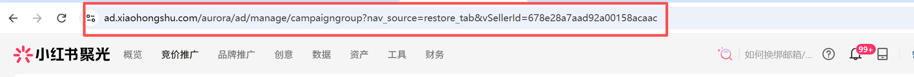

# 平台账号与连接状态

先选对客户，再保存连接并验证；已有可用连接时，不必重复配置。

## 先看需不需要自己配置

打开“平台账号”，查看团队已有的账号别名、所属团队、配置人和状态。如果已有正确客户的可用连接，直接在工具里选择即可，不必每人新增一份。

| 情况 | 你的下一步 |
| --- | --- |
| 不需要聚光/灵犀账号的工具 | 按工具要求上传资料，不必配置 Cookie。 |
| 已有正确客户的已验证连接 | 回到工具，在“使用账号”中选它。 |
| 没有所需客户或平台连接 | 点击“新增账号”，自行填写平台、服务、账号别名和所需连接信息，按下一节完成配置与验证。 |
| 看到已有平台账号但没有配置按钮 | 不能直接修改别人新增的账号。需要配置自己的连接时，可点击“新增账号”另行添加；已有连接仍可按当前权限使用。 |

Cookie 可以理解为平台登录后识别你身份的一段文字。它不是登录密码，也不是行业 code；只能填在对应平台账号的 Cookie 框中。

## 新增账号到验证成功

1. 点击“新增账号”，选择平台并填写具体服务，例如小红书下的聚光或灵犀。
2. 填写便于识别的“账号别名”。
3. 聚光账号还需填写目标客户内的完整“页面链接”。具体复制方法见下方“获取客户链接与 Cookie”。
4. 先保存账号，再打开“配置”，粘贴对应平台的 Cookie 并保存。
5. 点击“验证”，阅读返回提示。只有验证通过才说明本次连接检查成功；保存成功不代表验证通过。
6. 回到需要的工具，选择该账号，再进行小范围取数确认。

## 获取客户链接与 Cookie

Cookie 是平台登录后用于识别会话的一段文字，不是登录密码。请在自己有权使用的平台账号中获取，只粘贴到智采的账号配置框。

1. 使用电脑上的 Chrome 或 Edge 登录对应平台：聚光为 ad.xiaohongshu.com，灵犀为 idea.xiaohongshu.com。聚光还需先跳转到要取数的客户账号。
2. 聚光的“页面链接”：确认页面客户名称正确后，复制地址栏完整网址；需要含 vSellerId=。如果没有，先进入客户内的工具或广告管理页面，再查看地址。不要复制合作伙伴的客户列表页。

   

3. 在平台页面按 F12（或右键“检查”），进入 Network / 网络，选择 Fetch/XHR，再刷新页面或进行一次查询。
4. 点击刚产生、发往当前平台域名的业务请求，打开 Headers / 标头，在 Request Headers / 请求标头中找到 Cookie。不要复制 Response Headers / 响应标头里的 Set-Cookie。

   

5. 复制 Cookie 字段的完整值，也就是 name=value; name2=value2 这样的内容；不要带上“Cookie:”字段名，不要复制整段请求标头。
6. 回到智采“平台账号”，打开对应账号的“配置”，将内容粘贴到 Cookie 框并保存，再点击“验证”。确认没有贴错聚光与灵犀的账号。

### 没有看到 Cookie 怎么办？

确认请求发往当前平台域名、打开的是请求标头，且平台已登录。可换一条刚完成的业务请求；如果仍找不到，请熟悉该平台的同事协助定位，不要复制其他字段凑数。

### 验证报错该怎么做？

先记录提示，核对平台、客户页面链接及 Cookie 是否来自同一账号。服务忙碌时稍后再试；不要把所有失败都判断成 Cookie 过期。

不同浏览器的中文名称及平台页面位置可能不同；本节给出通用查看路径，当前尚未对每个平台逐屏截图验证。

## 状态和提示分别怎么处理

| 状态或提示 | 含义 | 建议操作 |
| --- | --- | --- |
| 未验证 | 信息尚未验证，或配置变更后需要重验 | 自己新增的平台账号，保存连接后点“验证”；他人新增的账号需联系该账号维护人更新。 |
| 已验证 | 连接已通过检查，但以后仍可能失效 | 在工具中选用；运行时仍以实际提示为准。 |
| 登录失效 | 平台登录信息不能继续使用 | 如果是自己新增的平台账号，在对应平台重新登录，获取新 Cookie，保存后再次验证。 |
| 已停用 | 该连接被停用，不能用于新任务 | 自己新增的平台账号可确认是否需要启用；无法操作他人账号时，选择其他正确账号或新增自己的连接。 |
| 尚未接入 | 自定义服务暂无对应取数功能 | 只能维护基本信息，暂时不能验证或采集。 |
| 验证失败 / 服务忙碌 | 不一定是 Cookie 过期，也可能是客户不匹配或暂时忙碌 | 先看具体提示，核对平台和客户；忙碌时稍后再试。 |

## 更新或删除前先确认

### 为什么打开配置框看不到已保存的 Cookie？

这是正常情况。Cookie 包含平台的登录凭据，直接显示原文可能被旁人看到、被截图记录或被复制，带来账号被他人使用的风险，因此已保存内容不回显。留空保存会保留原值；需要更新时，填写新 Cookie 并保存即可替换。

### 换了聚光客户链接后为什么要重验？

目标客户可能发生变化。确认链接和 Cookie 对应本次需要的客户，再重新验证，不能沿用旧验证结论。

### 删除平台账号会影响什么？

删除会清除该平台账号保存的登录凭据，后续不能再选择它发起新任务；已经产生的历史任务仍保留。删除前请确认这个平台账号已不再需要。

---

## 修改意见

